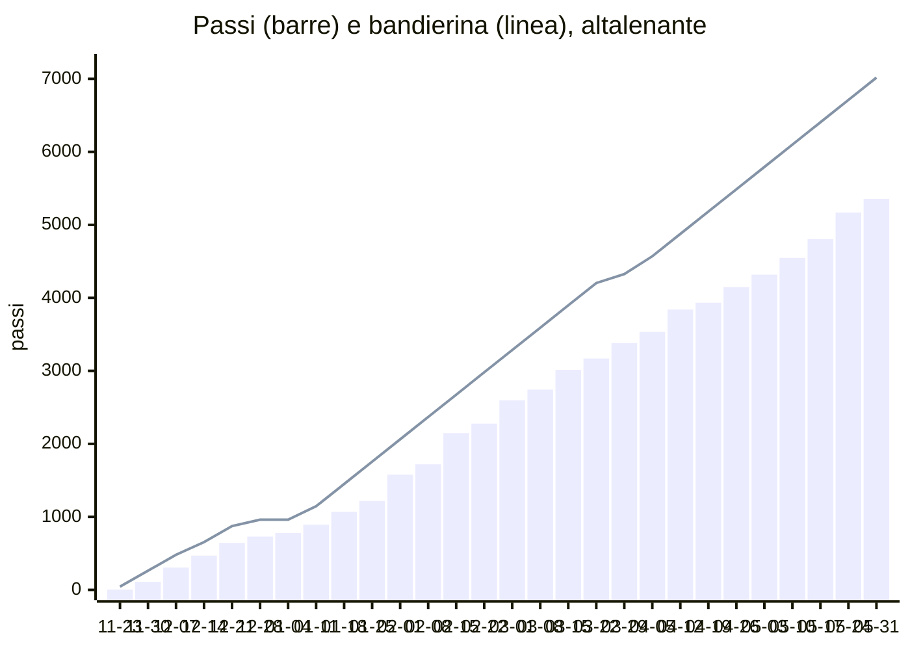

# Simulazione: altalenante

Profilo: settimane buone (95%) e storte (50%) a giro (seme 33). Dal 2026-11-23 al 2027-06-04, codice vero dei passi, delle chiavi, di voti e note e dei forzieri su PGlite con le migrazioni vere. Rigenerare con `npm run simula:anno`; i passi per giorno e per motivo sono in `altalenante.csv`.

| | |
|---|---|
| Passi a fine anno | 5591 su 7200 (tappa 22 di 27) |
| Cima | non raggiunta |
| Chiavi | 37 in 27 settimane, media 1.37 |
| Settimane con rimonta | 10 |
| Forzieri aperti | 7 di 9 |
| Figurine | 19 di 64 |
| Popup accodati | 362 |

## Passi per motivo

| Motivo | Passi |
|---|---|
| compito | 2065 |
| voto | 570 |
| ripasso | 562 |
| gesto | 550 |
| flashcard | 484 |
| cartella | 464 |
| quiz | 168 |
| borsa | 114 |
| foglio | 14 |
| sgridata | -29 |
| nota | -40 |

## Forzieri

| Forziere | Tappa | Chiavi | Enigma visibile dal | Aperto il |
|---|---|---|---|---|
| 1 | 3 | 2 | 2026-12-04 | 2026-12-14 |
| 2 | 6 | 4 | 2026-12-30 | 2027-01-12 |
| 3 | 9 | 7 | 2027-01-26 | 2027-01-31 |
| 4 | 12 | 14 | 2027-02-12 | 2027-02-21 |
| 5 | 15 | 17 | 2027-03-08 | 2027-03-16 |
| 6 | 18 | 21 | 2027-04-09 | 2027-04-19 |
| 7 | 21 | 26 | 2027-05-11 | 2027-05-21 |
| 8 | 24 | 31 | - | - |
| 9 | 27 | 36 | - | - |

## Chiavi per settimana

| Settimana | Cose fatte / possibili | Note | Chiavi | Rimonta |
|---|---|---|---|---|
| 2026-11-23 | 8 / 16 | 0 | 0 |  |
| 2026-11-30 | 20 / 21 | 0 | 3 |  |
| 2026-12-07 | 8 / 14 | 0 | 2 |  |
| 2026-12-14 | 19 / 22 | 1 | 1 |  |
| 2026-12-21 | 8 / 10 | 0 | 2 |  |
| 2026-12-28 | 2 / 3 | 0 | 0 |  |
| 2027-01-04 | 6 / 9 | 0 | 2 |  |
| 2027-01-11 | 18 / 21 | 0 | 2 |  |
| 2027-01-18 | 10 / 23 | 0 | 0 |  |
| 2027-01-25 | 20 / 21 | 0 | 3 | sì |
| 2027-02-01 | 12 / 22 | 2 | 0 |  |
| 2027-02-08 | 29 / 27 | 0 | 3 | sì |
| 2027-02-15 | 10 / 19 | 0 | 0 |  |
| 2027-02-22 | 22 / 22 | 0 | 3 | sì |
| 2027-03-01 | 12 / 20 | 0 | 0 |  |
| 2027-03-08 | 20 / 17 | 0 | 3 | sì |
| 2027-03-15 | 11 / 20 | 1 | 0 |  |
| 2027-03-22 | 16 / 16 | 0 | 3 | sì |
| 2027-03-29 | 12 / 20 | 0 | 0 |  |
| 2027-04-05 | 13 / 15 | 0 | 2 | sì |
| 2027-04-12 | 11 / 19 | 0 | 0 |  |
| 2027-04-19 | 14 / 16 | 0 | 2 | sì |
| 2027-04-26 | 15 / 28 | 0 | 0 |  |
| 2027-05-03 | 17 / 19 | 0 | 2 | sì |
| 2027-05-10 | 14 / 18 | 0 | 2 | sì |
| 2027-05-17 | 18 / 22 | 0 | 2 | sì |
| 2027-05-24 | 14 / 22 | 0 | 0 |  |
