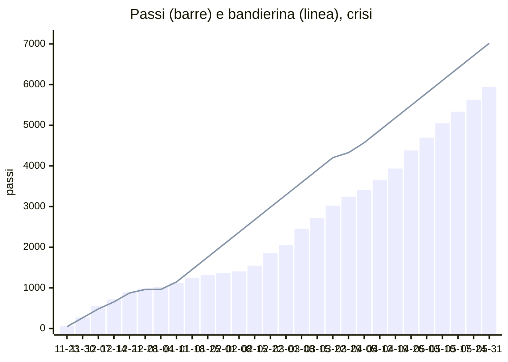

# Simulazione: crisi

Profilo: normale fino a gennaio, in crisi (40%) dal 7/1 al 14/2, poi in rimonta (92%) (seme 44). Dal 2026-11-23 al 2027-06-04, codice vero dei passi, delle chiavi, di voti e note e dei forzieri su PGlite con le migrazioni vere. Rigenerare con `npm run simula:anno`; i passi per giorno e per motivo sono in `crisi.csv`.

| | |
|---|---|
| Passi a fine anno | 6080 su 7200 (tappa 24 di 27) |
| Cima | non raggiunta |
| Chiavi | 50 in 27 settimane, media 1.85 |
| Settimane con rimonta | 16 |
| Forzieri aperti | 8 di 9 |
| Figurine | 20 di 64 |
| Popup accodati | 377 |

## Passi per motivo

| Motivo | Passi |
|---|---|
| compito | 2322 |
| voto | 620 |
| gesto | 598 |
| cartella | 505 |
| flashcard | 493 |
| ripasso | 292 |
| quiz | 162 |
| borsa | 124 |
| foglio | 25 |
| sgridata | -7 |
| note_dimenticanza | -10 |

## Forzieri

| Forziere | Tappa | Chiavi | Enigma visibile dal | Aperto il |
|---|---|---|---|---|
| 1 | 3 | 2 | 2026-11-30 | 2026-12-06 |
| 2 | 6 | 4 | 2026-12-15 | 2026-12-23 |
| 3 | 9 | 7 | 2027-01-21 | 2027-02-15 |
| 4 | 12 | 14 | 2027-02-28 | 2027-03-04 |
| 5 | 15 | 17 | 2027-03-16 | 2027-03-22 |
| 6 | 18 | 21 | 2027-04-11 | 2027-04-19 |
| 7 | 21 | 26 | 2027-05-02 | 2027-05-08 |
| 8 | 24 | 31 | 2027-05-25 | 2027-06-03 |
| 9 | 27 | 36 | - | - |

## Chiavi per settimana

| Settimana | Cose fatte / possibili | Note | Chiavi | Rimonta |
|---|---|---|---|---|
| 2026-11-23 | 17 / 18 | 1 | 1 |  |
| 2026-11-30 | 16 / 22 | 0 | 2 |  |
| 2026-12-07 | 15 / 15 | 0 | 3 |  |
| 2026-12-14 | 17 / 21 | 0 | 2 |  |
| 2026-12-21 | 9 / 8 | 0 | 3 |  |
| 2026-12-28 | 2 / 3 | 0 | 0 |  |
| 2027-01-04 | 8 / 14 | 0 | 0 |  |
| 2027-01-11 | 17 / 24 | 0 | 2 |  |
| 2027-01-18 | 7 / 21 | 0 | 0 |  |
| 2027-01-25 | 3 / 19 | 0 | 0 |  |
| 2027-02-01 | 5 / 17 | 2 | 0 |  |
| 2027-02-08 | 9 / 15 | 1 | 1 | sì |
| 2027-02-15 | 19 / 17 | 0 | 3 | sì |
| 2027-02-22 | 14 / 19 | 0 | 2 | sì |
| 2027-03-01 | 22 / 22 | 0 | 3 | sì |
| 2027-03-08 | 18 / 19 | 0 | 2 | sì |
| 2027-03-15 | 17 / 17 | 0 | 3 | sì |
| 2027-03-22 | 11 / 12 | 0 | 2 | sì |
| 2027-03-29 | 12 / 13 | 0 | 2 | sì |
| 2027-04-05 | 16 / 19 | 0 | 2 | sì |
| 2027-04-12 | 18 / 16 | 0 | 3 | sì |
| 2027-04-19 | 21 / 23 | 0 | 2 | sì |
| 2027-04-26 | 19 / 22 | 0 | 2 | sì |
| 2027-05-03 | 22 / 21 | 0 | 3 | sì |
| 2027-05-10 | 17 / 24 | 0 | 2 | sì |
| 2027-05-17 | 21 / 20 | 0 | 3 | sì |
| 2027-05-24 | 20 / 22 | 0 | 2 | sì |
