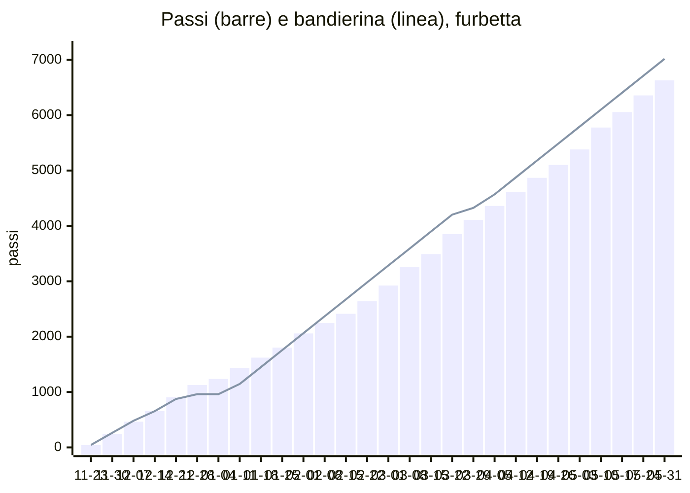

# Simulazione: furbetta

Profilo: fa il 70%, spunta compiti non fatti e prova caselle e passi in più (seme 55). Dal 2026-11-23 al 2027-06-04, codice vero dei passi, delle chiavi, di voti e note e dei forzieri su PGlite con le migrazioni vere. Rigenerare con `npm run simula:anno`; i passi per giorno e per motivo sono in `furbetta.csv`.

| | |
|---|---|
| Passi a fine anno | 6780 su 7200 (tappa 25 di 27) |
| Cima | non raggiunta |
| Chiavi | 51 in 27 settimane, media 1.89 |
| Settimane con rimonta | 6 |
| Forzieri aperti | 8 di 9 |
| Figurine | 16 di 64 |
| Popup accodati | 503 |

## Passi per motivo

| Motivo | Passi |
|---|---|
| compito | 2307 |
| flashcard | 1780 |
| gesto | 846 |
| cartella | 448 |
| ripasso | 432 |
| voto | 365 |
| quiz | 221 |
| borsa | 112 |
| compito_rifatto | 80 |
| foglio | 13 |
| note_dimenticanza | -10 |
| sgridata | -21 |
| nota | -40 |
| storno | -198 |

## Forzieri

| Forziere | Tappa | Chiavi | Enigma visibile dal | Aperto il |
|---|---|---|---|---|
| 1 | 3 | 2 | 2026-12-01 | 2026-12-06 |
| 2 | 6 | 4 | 2026-12-16 | 2026-12-22 |
| 3 | 9 | 7 | 2027-01-08 | 2027-01-15 |
| 4 | 12 | 14 | 2027-01-29 | 2027-02-07 |
| 5 | 15 | 17 | 2027-02-25 | 2027-03-02 |
| 6 | 18 | 21 | 2027-03-18 | 2027-03-25 |
| 7 | 21 | 26 | 2027-04-12 | 2027-04-20 |
| 8 | 24 | 31 | 2027-05-09 | 2027-05-17 |
| 9 | 27 | 36 | - | - |

## Chiavi per settimana

| Settimana | Cose fatte / possibili | Note | Chiavi | Rimonta |
|---|---|---|---|---|
| 2026-11-23 | 15 / 14 | 0 | 3 |  |
| 2026-11-30 | 12 / 18 | 0 | 2 |  |
| 2026-12-07 | 16 / 16 | 0 | 3 |  |
| 2026-12-14 | 16 / 19 | 0 | 2 |  |
| 2026-12-21 | 11 / 9 | 0 | 3 |  |
| 2026-12-28 | 1 / 3 | 0 | 0 |  |
| 2027-01-04 | 9 / 12 | 0 | 2 |  |
| 2027-01-11 | 17 / 18 | 0 | 2 |  |
| 2027-01-18 | 14 / 19 | 1 | 1 |  |
| 2027-01-25 | 17 / 17 | 0 | 3 |  |
| 2027-02-01 | 13 / 18 | 0 | 2 |  |
| 2027-02-08 | 14 / 19 | 0 | 2 |  |
| 2027-02-15 | 16 / 19 | 0 | 2 |  |
| 2027-02-22 | 14 / 18 | 1 | 1 |  |
| 2027-03-01 | 16 / 24 | 0 | 2 | sì |
| 2027-03-08 | 18 / 17 | 0 | 3 |  |
| 2027-03-15 | 16 / 20 | 1 | 1 | sì |
| 2027-03-22 | 13 / 14 | 0 | 2 | sì |
| 2027-03-29 | 13 / 18 | 0 | 2 |  |
| 2027-04-05 | 17 / 18 | 0 | 2 |  |
| 2027-04-12 | 17 / 23 | 0 | 2 |  |
| 2027-04-19 | 17 / 21 | 1 | 1 |  |
| 2027-04-26 | 17 / 19 | 0 | 2 | sì |
| 2027-05-03 | 18 / 20 | 0 | 2 | sì |
| 2027-05-10 | 17 / 25 | 0 | 0 |  |
| 2027-05-17 | 18 / 18 | 0 | 3 | sì |
| 2027-05-24 | 14 / 16 | 1 | 1 |  |
